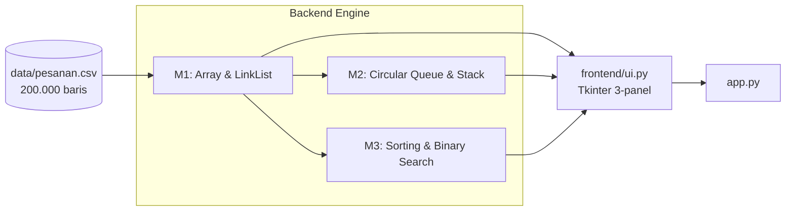

# LAPORAN PENGEMBANGAN 2EZ4U APP - Delivery Service Backend Engine

> **Mata Kuliah:** Struktur Data & Analisa Algoritma (EC234303) - FTEIC ITS (Gasal 2026/2027)
> **Dosen:** Ir. Arta Kusuma Hernanda, S.T., M.T. | **Mahasiswa:** M. Gielang Fitrawan Mukhlish (5024251019) - Kelas A
> **Repo:** `https://github.com/Jsooonx/2ez4u.git`

## 1. Deskripsi

Simulasi engine backend layanan pesan-antar makanan yang menguji struktur data buatan sendiri pada **200.000 pesanan** (`data/pesanan.csv`). Progres saat ini: **M1 - M3** (M4 - M6 menyusul).

* **Dilarang:** `dict`, `{}`, `set`, `sorted()`, `.sort()`, `heapq`, `bisect`, `collections.*`, comprehension.
* **Diperbolehkan:** `list` sebagai array primitif (`[None] * capacity`), `tuple`, class OOP, aritmetika, file I/O.



## 2. Milestone

| M | Struktur Data & Algoritma | Berkas | Status |
| :-: | :--- | :--- | :-: |
| **M1** | Dynamic Array vs Singly Linked List | `backend/m1_pesanan.py` | Selesai |
| **M2** | Circular Queue (FIFO) & Stack (Undo) | `backend/m2_antrean.py` | Selesai |
| **M3** | Insertion/Selection/Bubble Sort & Binary Search | `backend/m3_laporan.py` | Selesai |
| M4 - M6 | Hash & Merge Sort, BST & MinHeap, Graf (BFS/Dijkstra) | - | Belum dikerjakan |

### M1 - Array vs Linked List
Prioritas pesanan menentukan posisi sisip: Reguler (belakang), Prioritas (tengah), VIP (indeks 0). `Pesanan` memakai `__slots__` untuk menghemat RAM.

| Operasi (200.000 data) | Array | Linked List | Pemenang |
| :--- | :---: | :---: | :--- |
| Akses indeks $n/2$ | **0.005 ms** | 11.684 ms | Array ($O(1)$ vs $O(n)$) |
| Tambah Reguler | 0.006 ms | **0.005 ms** | Imbang ($O(1)$) |
| Tambah Prioritas | 22.290 ms | **6.209 ms** | Linked List |
| Tambah VIP | 56.676 ms | **0.016 ms** | Linked List (~3.500x) |

### M2 - Circular Queue & Stack
* **Circular Queue:** indeks modulo `(idx + 1) % capacity`, tanpa pergeseran data.
* **Stack:** riwayat aksi kasir untuk undo, $O(1)$.
* **Undo:** `requeue_front()` (batal layani) dan `unqueue_rear()` (batal masuk), keduanya $O(1)$ dibanding `insert(0)` / `pop(0)` array biasa yang $O(n)$.

### M3 - Sorting & Binary Search
`insertion_sort` (utama, adaptif), dibandingkan dengan `selection_sort` dan `bubble_sort`; `binary_search` $O(\log n)$ dibanding `linear_search` $O(n)$.

| Algoritma | Data | Waktu | Kompleksitas |
| :--- | :---: | :---: | :---: |
| **Insertion Sort** | 500 | **5.210 ms** | $O(n^2)$ |
| Selection Sort | 500 | 14.832 ms | $O(n^2)$ |
| Bubble Sort | 500 | 18.642 ms | $O(n^2)$ |
| **Binary Search** | 1.000 | **0.032 ms** | $O(\log n)$ |
| Linear Search | 1.000 | 0.054 ms | $O(n)$ |

## 3. Antarmuka (Tkinter 3-panel)

Aplikasi desktop GUI dibangun menggunakan `tkinter` dengan tata letak 3-panel terintegrasi:
* **Panel Kiri (Sidebar Navigasi):** Memuat data CSV 200.000 baris, tombol operasi M1 (Array vs Linked List), operasi M2 (Antrean Dapur & Undo), operasi M3 (Laporan Terurut & Pencarian), serta tombol pintas duel benchmark.
* **Panel Kanan (Form Parameter Dinamis & Display):** Menampilkan input parameter form yang adaptif terhadap pilihan menu serta area hasil luaran berformat ASCII terstruktur (81 karakter).
* **Panel Bawah (Command & Benchmark Log):** Terminal log pencatat setiap aksi yang baru saja dieksekusi lengkap dengan stopwatch waktu presisi tinggi (`time.perf_counter()`) dalam satuan milidetik (ms).

## 4. Menjalankan

```bash
git clone https://github.com/Jsooonx/2ez4u.git
cd 2ez4u
python app.py
```
Klik **Load CSV (200.000)** di sidebar, lalu pilih operasi M1, M2, atau M3. Butuh Python 3.11+ (Tkinter bawaan).

## 5. Struktur Direktori

```text
2ez4u/
├── app.py                 <- Entry point GUI
├── backend/               <- m1_pesanan.py, m2_antrean.py, m3_laporan.py
├── frontend/ui.py         <- Layout 3-panel Tkinter
├── data/                  <- pesanan.csv, peta.csv
└── docs/                  <- Panduan komprehensif & dokumentasi teknis M1-M3
```

## 6. Kesimpulan (M1 - M3)

1. **M1:** Array unggul di akses acak $O(1)$; Linked List unggul di penyisipan depan $O(1)$.
2. **M2:** Circular Queue menghilangkan pergeseran $O(n)$; Stack memberi undo instan $O(1)$.
3. **M3:** Data terurut memungkinkan Binary Search $O(\log n)$; Insertion Sort paling efisien di antara sort kuadratik.
